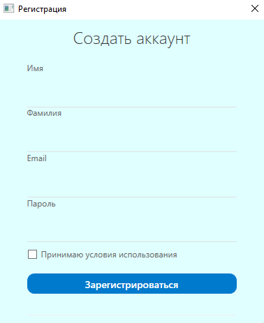
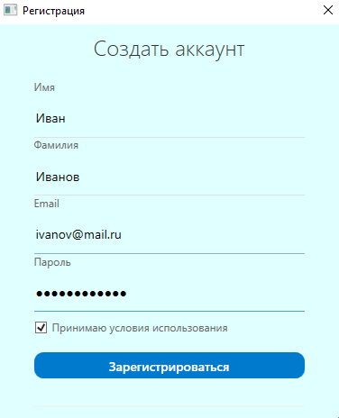
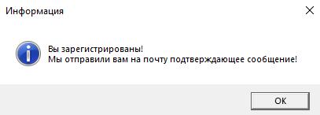
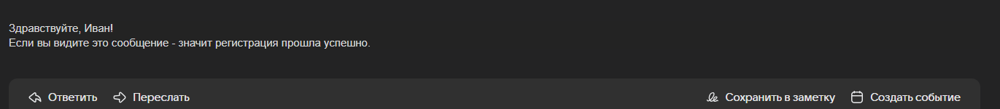

# RegistrationApp (WPF + PostgreSQL)

WPF-приложение для регистрации пользователей с валидацией данных, сохранением в базу данных PostgreSQL и отправкой email-подтверждений. 

## Быстрый старт 🚀

### Предварительные требования ⚙️
- ОС: Windows 10/11
- Платформа: .NET 6.0+
- IDE: Visual Studio 2022
- БД: PostgreSQL 12+
- SMTP-сервер для отправки email(Gmail, Mail, Yandex)

### Установка и запуск 🔧
1. Скачайте архив или клонируйте репозиторий(если установлен git)
   ```bash
   git clone https://github.com/BanCoder/RegistrationApp.git
   cd RegistrationApp
   ```
2. Настройте конфигурацию

	Создайте конфигурационный файл (`appsettings.json`): 
```json
{
	"SmtpSettings": {
		"Gmail": {
			"Server": "smtp.gmail.com",
			"Port": 587, 
			"AdminLogin": "your-email@gmail.com",
			"Password": "your-app-password"
		},
		"MailRu": {
			"Server": "smtp.mail.ru",
			"Port": 587,
			"AdminLogin": "your-email@mail.ru",
			"Password": "your-app-password"
		},
		"Yandex": {
			"Server": "smtp.yandex.ru",
			"Port": 465,
			"AdminLogin": "your-email@yandex.ru",
			"Password": "your-app-password"
		}
	},
	"ConnectionSettings": {
		"sqlConnection": "Server=localhost;Port=5432;Database=registration_db; User Id=postgres; Password=your-password"
	}
}
```
>***Важно отметить!***
В полях `"Port"`, `"AdminLogin"`, `"Password"` и `"sqlConnection"` проекта приведены данные для примера. В этих полях вы должны вводить свои данные. 
- В поле `"Port"` вы вводите номер порта, какой захотите(в моем случае это 587)
- В поле `"AdminLogin"` вы вводите логин электронной почты, с которой будут отправляться сообщения для нового пользователя  
- В поле `"Password"` вы вводите "пароль приложений", который будет сгенерирован для каждой почты автоматически
    - Как найти "пароль приложений"? 
        - **Для Gmail**: [Инструкция](https://support.google.com/accounts/answer/185833)
        - **Для Mail**: [Инструкция](https://help.mail.ru/mail/security/protection/external)
        - **Для Yandex**: [Инструкция](https://yandex.ru/support/id/authorization/app-passwords.html)

3. Создайте базу данных в PostgreSQL: 
    - Откройте pgAdmin 4
    - Создайте базу данных `registration_db`
    - Напишите запрос на создание таблицы (`users`): 
        ```sql
        create table Users
        (
			id serial primary key, 
			first_name varchar(50) not null,
			last_name varchar(50) not null,
			email varchar(50) unique not null,
			usr_pass varchar(255) not null
        );
        ```
4. Запустите программу в Visual Studio 2022
   - Откройте решение `RegistrationApp.sln`
   - Нажмите на `F5` или на кнопку `Пуск`
   - Перейдите в папку `bin\Debug` и запустите .exe файл

### Скриншоты 🖼️


*Главное окно*



*Пример заполнения полей*



*Результат программы*



*Почтовое подтверждение*

### Особенности ✅
- Валидация данных пользователя
- Автоматическое сохранение данных о пользователях в PostgreSQL
- Отправка email-подтверждения
- Безопасное хранение данных
  
### Архитектура 🛠️
#### Технологический стек 💻 
- WPF - пользовательский интерфейс
- MVVM - архитектурный паттерн
- PostgreSQL - СУБД (система управления базами данных)
- SMTP клиент для отправки сообщений на почту

#### Основные компоненты 📃
- Models - сущности предметной области 
- ViewModels - логика и привязка данных 
- Views - пользовательский интерфейс

